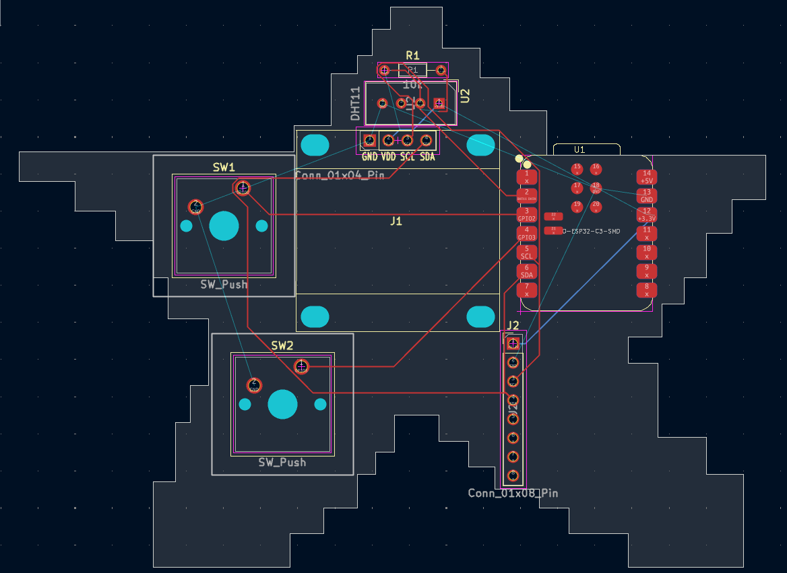
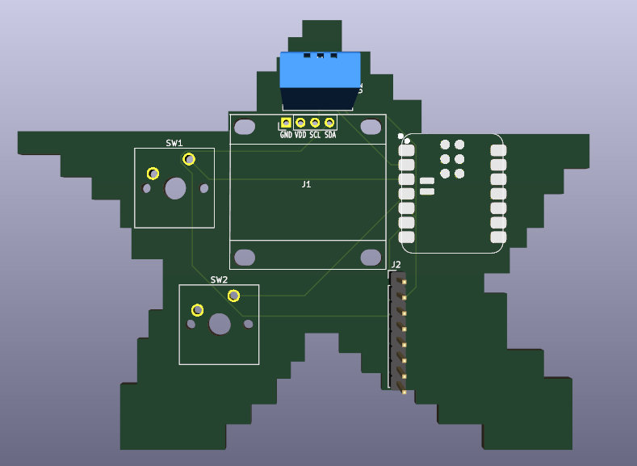
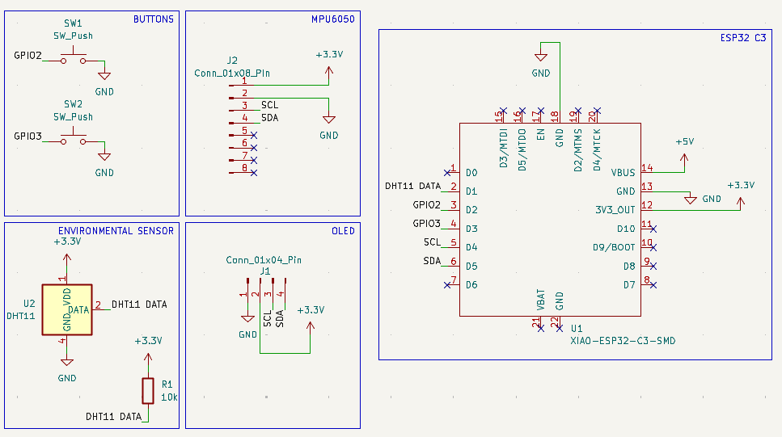

# Starbie — Motion-Controlled Digital Pet

Starbie is a small motion-controlled digital pet inspired by Tamagotchi. The idea is to make a little desktop pet that can react to movement and be a fun project to interact with.

## Project Status

I've finished designing the schematic and PCB layout in KiCad. I haven't been able to get the physical parts or assemble the board yet, so the project is still at the digital design stage.

## Hardware Design

I used KiCad to design the circuit and PCB. The files are included in this repository so the design can be viewed and worked on further.

- Schematic: `Starbie.kicad_sch`
- PCB layout: `Starbie.kicad_pcb`
- Project file: `Starbie.kicad_pro`

## Design Preview

### PCB Layout

### 3D Preview

### Schematic

## Firmware

The firmware is part of the project and is being added to the repository. It will be used to make the pet work with the hardware once everything is assembled.

## What's Next

- Finish organizing the project files.
- Check the PCB design and schematic.
- Generate the files needed to manufacture the board.
- Get the physical parts and PCB.
- Assemble everything and test the firmware.

## Current Limitations

I haven't built or tested the physical hardware yet because I don't have the board or components. For now, I've been focusing on getting the digital design done and preparing the project for the next steps.
